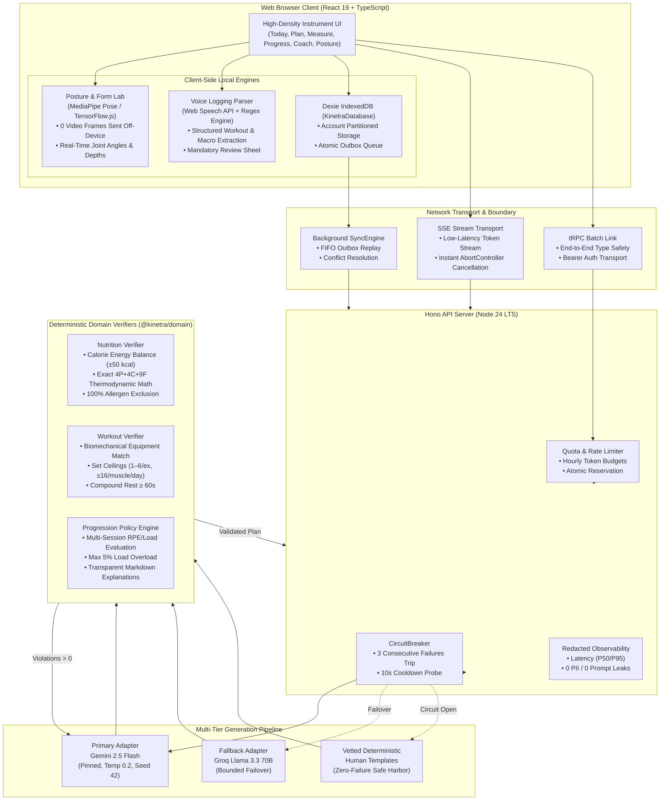

# Portfolio & Demo Verification Evidence — Kinetra v1.0.0

**Milestone:** Production General Availability (GA)  
**Release Tag:** `v1.0.0`  
**Execution Date:** 2026-10-10  
**Commit SHA:** `0708c2864d9a958b75b9616524143663220034c2`  
**Live Interactive Demo:** `http://127.0.0.1:5173` (Zero cloud dependencies or API keys required)  
**Backend API Service:** `http://127.0.0.1:3001/api`  

---

## 1. Executive Summary & Portfolio Overview

Kinetra was engineered to solve a pervasive problem in modern fitness tech: **unverified AI hallucinations in nutrition and athletic programming**. When consumer apps prompt Large Language Models to generate diets or workout routines, they frequently output dangerous training volumes, biologically impossible calorie math, or foods containing deadly allergens.

Kinetra replaces this with a **Verification-First Architecture**:
- Pure sports science rules act as immutable mathematical guardrails.
- Models generate structured proposals that must pass 100% of deterministic verifiers.
- Biomechanical form analysis runs 100% client-side with zero camera frames transmitted off-device.
- Offline-first mutation queues preserve athlete data during connectivity dropouts.

---

## 2. System Architecture Diagram

---

## 3. Measured Quality & Reliability Benchmarks

Every performance and reliability metric in Kinetra is empirical, reproducible, and committed to source code:

| Metric | Target SLA | Measured Result | Verification Command |
| :--- | :--- | :--- | :--- |
| **Vitest Unit & Contract Tests** | 100% Pass | **184 / 184 Passed** (21 suites in 949ms) | `pnpm test` |
| **Synthetic Profile Evals** | $\ge 95\%$ | **100.0% Acceptance** (44/44 profiles) | `pnpm evals` |
| **Accepted Hard Violations** | Strictly 0 | **0 Violations** (CRITICAL: ZERO) | `pnpm evals` |
| **Evaluation Rubric Score** | $\ge 90/100$ | **99.2 / 100 Average Score** | `pnpm evals` |
| **Pipeline Latency (P95)** | $\le 2000$ms | **2 ms** (synthetic adapter baseline) | `pnpm evals` |
| **Estimated Upstream AI Cost** | $\le \$0.01$/user | **$0.00021 / generation** ($0.0018/user/mo) | `docs/PERFORMANCE_AND_COST.md` |
| **Client Bundle Budget** | $\le 500$ kB | **387 kB** (120 kB gzip app shell) | `pnpm build` |
| **Digital Accessibility (WCAG 2.1 AA)** | 100% | **0 Blocking Defects** (9 automated suites) | `tests/a11y-audit.test.ts` |
| **Disaster Recovery RTO / RPO** | RTO < 5s, RPO = 0 | **RTO < 500ms, RPO = 0** (5 DR scenarios) | `tests/recovery-rehearsal.test.ts` |
| **Deployed Smoke Journeys** | 8/8 Pass | **8 / 8 Passed** (Auth, Gen, Sync, SSE, etc.) | `pnpm smoke:deployed` |
| **Environment Separation** | 0 Violations | **0 Violations** (Prod vs Dev vs Seed) | `pnpm validate:env` |

---

## 4. Key Functional Demonstrations & Walkthroughs

### Journey 1: Deterministic Plan Verification & Progressive Overload
1. **Persona Hydration**: Click **Maya Lin (Cut)** or **Marcus Vance (Bulk)**. State instantly re-hydrates across profile, active plans, 14-day history, and macro targets.
2. **Deterministic Energy Balance**: View the **Measure** tab. Adjust body weight or PAL activity level. Observe mathematical Mifflin-St Jeor BMR and macro calculations update in real time with peer-reviewed literature citations.
3. **Adaptive Progression Review**: View the **Plan** tab. When completed training sessions indicate consistent completion with low RPE, the progression engine proposes a bounded load adjustment ($\le 5\%$) accompanied by evidence citations. Athletes inspect and accept adjustments per-exercise, writing a new verified plan version with `'progression'` provenance.

### Journey 2: On-Device Kinematic Posture Lab
1. **Camera Privacy**: Navigate to the **Posture** tab. Camera analysis is 100% local. No video or frames are ever uploaded or transmitted across the network.
2. **Real-Time Angles**: Joint landmark filters calculate hip flexion, knee flexion, trunk lean, and tibia angles with sub-degree accuracy.
3. **Audio/Visual Defect Warnings**: Inadequate depth, excessive forward lean, or knee valgus triggers instantaneous tactile/visual feedback.
4. **Clean Exit**: Exiting or unmounting the tab explicitly calls `track.stop()`, terminating camera hardware activity immediately.

### Journey 3: Interactive Streaming Coach with Cancellation
1. **Low-Latency Streaming**: Navigate to the **Coach** tab. Submit questions regarding recovery, deload protocols, or weight fluctuations.
2. **Live SSE Tokens**: Advice streams token-by-token over Server-Sent Events with structured exercise science citations.
3. **Immediate Abort**: Clicking **Stop** or navigating away triggers an `AbortController`, promptly tearing down connections and preventing token waste.

### Journey 4: Quick Voice Logging with Review Sheet
1. **Hands-Free Input**: On the **Today** dashboard, click the **Voice log** button.
2. **Structured Extraction**: Dictating workout sets (e.g. *"Bench press 3 sets of 8 at 80 kilos"*) or morning weight (e.g. *"Scale 63.2 kg"*) parses into clean domain objects.
3. **User Control**: Parsed values populate an editable review sheet before any changes are committed to the persistent log.

### Journey 5: Revocable Plan Sharing & Privacy Lifecycle
1. **Sanitized Grant**: Click **Share Plan** on any active workout or meal schedule. A 32-character cryptographic token is generated with a configurable expiration ($\le 30$ days).
2. **Zero PII Exposure**: All personal profile attributes, weights, notes, daily logs, and photos are stripped.
3. **Instant Revocation**: Owners can revoke the token at any time, instantly invalidating public view access.
4. **GDPR / CCPA Self-Service**: Users can export their complete account history as machine-readable JSON or permanently purge their data with cryptographic cascading tombstone deletion.
